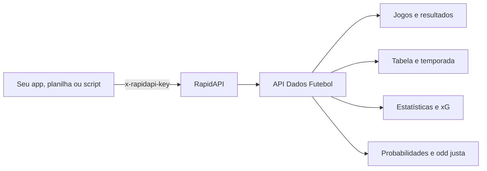

<p align="center">
  <a href="https://www.apidadosfutebol.com">
    
  </a>
</p>

<p align="center">
  <a href="https://rapidapi.com/wagnyoliver/api/futapi"></a>
  <a href="https://www.apidadosfutebol.com/docs"></a>
  
  
</p>

<p align="center">
  <b>API de futebol</b> com jogos, resultados, tabela, escalações, estatísticas, <b>xG</b>, <b>ratings de jogadores</b> e <b>probabilidades pré-jogo com odd justa</b>.<br>
  Exemplos prontos em <b>Python</b>, <b>JavaScript</b> e <b>Google Sheets</b>.
</p>

<p align="center">
  <a href="#-começar-em-2-minutos">Começar</a> ·
  <a href="#-exemplos">Exemplos</a> ·
  <a href="#-o-que-a-api-entrega">Recursos</a> ·
  <a href="#-competições">Competições</a> ·
  <a href="#-planos">Planos</a> ·
  <a href="#-english">English</a>
</p>

---

## ⚡ Começar em 2 minutos

1. Assine o **plano grátis** (100 requisições/dia) em [rapidapi.com/wagnyoliver/api/futapi](https://rapidapi.com/wagnyoliver/api/futapi).
2. Copie sua chave `x-rapidapi-key`.
3. Faça a primeira chamada:

```bash
curl "https://futapi.p.rapidapi.com/v1/matches?timezone=America/Sao_Paulo" \
  -H "x-rapidapi-host: futapi.p.rapidapi.com" \
  -H "x-rapidapi-key: SUA_CHAVE"
```

Ou rode os exemplos deste repositório:

```bash
git clone https://github.com/uagwn/apidadosfutebol.git
cd apidadosfutebol/python
pip install -r requirements.txt
export RAPIDAPI_KEY="sua_chave"        # Windows PowerShell: $env:RAPIDAPI_KEY = "sua_chave"
python 01_tabela_brasileirao.py
```

## 🧭 Como funciona



Todas as respostas seguem o mesmo formato:

```json
{
  "data": { "...": "o recurso pedido" },
  "paging": { "next_cursor": "bzoxMDA", "limit": 100 },
  "meta": null
}
```

## 🧪 Exemplos

Saídas reais dos scripts deste repositório.

### Tabela do Brasileirão: [`python/01_tabela_brasileirao.py`](python/01_tabela_brasileirao.py)

```text
Brasileirão Série A 2026

 #  Time                      J   V   E   D   SG  Pts
 1  Flamengo                 34  23   7   4   42   76
 2  Palmeiras                34  21  10   3   39   73
 3  Cruzeiro                 34  18   6  10    7   60
```

### Jogos do dia no horário de Brasília: [`python/02_jogos_do_dia.py`](python/02_jogos_do_dia.py)

```text
21:00  Primera A Colombia           Junior FC x Cúcuta  [scheduled]
```

### Probabilidades, odd justa e value bet: [`python/03_probabilidades_e_value_bet.py`](python/03_probabilidades_e_value_bet.py)

```bash
python 03_probabilidades_e_value_bet.py mt_xxxxxxxxxxxx 2.10 3.30 3.60
```

```text
Junior FC x Cúcuta  (2026-11-09T21:00:00-03:00)

Gols esperados: 2.06 x 1.23

Mandante     53.2%  odd justa  1.88  odd mercado  2.10  EV +11.8%  <- valor
Empate       25.3%  odd justa  3.95  odd mercado  3.30  EV -16.4%
Visitante    21.4%  odd justa  4.67  odd mercado  3.60  EV -22.9%

Over 2.5:     63.9%
Ambos marcam: 63.8%
Placares mais prováveis: 1-1 (11.5%), 2-1 (9.7%), 2-0 (7.9%)
```

Entenda os números: [como calcular a odd justa](https://www.apidadosfutebol.com/blog/como-calcular-odd-justa) e [value bet](https://www.apidadosfutebol.com/blog/value-bet).

### Média de escanteios, cartões, gols e xG por time: [`python/04_estatisticas_dos_times.py`](python/04_estatisticas_dos_times.py)

```text
Brasileirão Série A 2026 - médias por jogo

Time                      J  Escanteios  Amarelos  Gols pró     xG  Over 2.5
Bahia                    34       11.82      2.44      1.47   1.53       53%
Red Bull Bragantino      34       11.71      2.59      1.29   1.56       41%
Sao Paulo                34       11.71      2.35      1.15   1.42       38%
```

### Todos os exemplos

| Linguagem | Arquivo | O que faz | Plano |
|---|---|---|---|
| Python | [01_tabela_brasileirao.py](python/01_tabela_brasileirao.py) | Classificação do Brasileirão | BASIC |
| Python | [02_jogos_do_dia.py](python/02_jogos_do_dia.py) | Jogos de hoje no horário de Brasília | BASIC |
| Python | [03_probabilidades_e_value_bet.py](python/03_probabilidades_e_value_bet.py) | Probabilidades, odd justa e valor esperado | ULTRA |
| Python | [04_estatisticas_dos_times.py](python/04_estatisticas_dos_times.py) | Médias de escanteios, cartões, gols e xG | PRO |
| Python | [05_exportar_jogos_csv.py](python/05_exportar_jogos_csv.py) | Exporta os jogos de uma temporada para CSV | BASIC |
| JavaScript | [01_jogos_do_dia.mjs](javascript/01_jogos_do_dia.mjs) | Jogos de hoje | BASIC |
| JavaScript | [02_probabilidades.mjs](javascript/02_probabilidades.mjs) | Probabilidades e odd justa | ULTRA |
| JavaScript | [03_tabela_casa_fora.mjs](javascript/03_tabela_casa_fora.mjs) | Tabela só em casa e só fora | BASIC |
| Google Sheets | [Code.gs](google-sheets/Code.gs) | Planilha com a tabela atualizada todo dia | BASIC |

## 📦 O que a API entrega

| | Recurso | Detalhes |
|---|---|---|
| 🏆 | **Tabela e temporada** | Classificação geral, em casa e fora, calendário, resultados e temporadas anteriores |
| 📋 | **Estatísticas por partida** | 35 métricas por time (jogo inteiro e por tempo) e 62 por jogador, eventos e escalações |
| 🎯 | **xG** | Gols esperados por time e jogador, xG a favor e contra na temporada, xGOT e gols evitados |
| ⭐ | **Rating de jogadores** | Nota de 0 a 10 por partida, com ataque, defesa, passe e posse |
| 📊 | **Probabilidades pré-jogo** | Vitória, empate e derrota com odd justa, over 0.5 a 4.5, ambos marcam, placares prováveis |
| ⚔️ | **Confronto direto** | Últimos encontros e médias de gols, posse, finalizações, escanteios, cartões e xG |

Dados atualizados a cada **5 minutos** e auditados diariamente. Referência completa: [apidadosfutebol.com/referencia](https://www.apidadosfutebol.com/referencia).

## 🌎 Competições

| Brasil e América do Sul | Ligas europeias | Copas europeias | Seleções e outras |
|---|---|---|---|
| Brasileirão Série A | Premier League | UEFA Champions League | Copa do Mundo |
| Brasileirão Série B | Championship | UEFA Europa League | Eurocopa |
| Copa do Brasil | La Liga | FA Cup | Copa América |
| Copa Libertadores | Serie A | EFL Cup | Copa Africana de Nações |
| Copa Sul-Americana | Bundesliga | Copa del Rey | Copa da Ásia |
| Liga Profesional Argentina | Ligue 1 | Coppa Italia | Gold Cup |
| Primera A Colômbia | Ligue 2 | DFB-Pokal | MLS |
| Liga 1 Peru | Eredivisie | Coupe de France | Liga MX |
| | Liga Portugal | | Saudi Pro League |
| | Belgian Pro League | | |
| | Süper Lig | | |
| | Russian Premier League | | |

37 competições, com histórico desde 2019 ou 2020. Estatísticas por time: [apidadosfutebol.com/estatisticas](https://www.apidadosfutebol.com/estatisticas).

## 💳 Planos

| Plano | Preço | Requisições/dia | Inclui |
|---|---|---|---|
| **BASIC** | Grátis | 100 | Competições, tabela, jogos, times, jogadores |
| **PRO** | US$ 9,99/mês | 5.000 | + eventos, escalações, estatísticas de partida e temporada |
| **ULTRA** | US$ 24,99/mês | 30.000 | + probabilidades, confronto direto, xG de jogadores, ratings |
| **MEGA** | US$ 59,99/mês | 150.000 | Tudo do ULTRA com cota maior |

Assinatura pela [RapidAPI](https://rapidapi.com/wagnyoliver/api/futapi).

## 🔎 Casos de uso

- **App de resultados e placar ao vivo:** jogos do dia, tabela, escalações e eventos.
- **Ferramentas de apostas e trading esportivo:** probabilidades, odd justa, value bet e médias de escanteios e cartões.
- **Fantasy e palpites:** ratings, xG e estatísticas individuais.
- **Análise de dados e jornalismo:** séries históricas, rankings e exportação para CSV, Excel e Google Sheets.
- **Bots** de Telegram e Discord com resultados e estatísticas.

## ❓ Perguntas frequentes

<details>
<summary><b>Existe API de futebol grátis?</b></summary>

Sim. O plano BASIC é gratuito, com 100 requisições por dia, e cobre competições, tabela, jogos, resultados, times e jogadores.
</details>

<details>
<summary><b>A API tem dados do Brasileirão?</b></summary>

Sim: Brasileirão Série A e Série B, Copa do Brasil, Libertadores e Sul-Americana, com temporadas desde 2020.
</details>

<details>
<summary><b>Como pegar as odds e probabilidades de um jogo?</b></summary>

Use `GET /v1/matches/{match_id}/prediction` (plano ULTRA). A resposta traz probabilidade e odd justa de vitória, empate e derrota, gols esperados, over/under e ambos marcam. Veja o exemplo [03_probabilidades_e_value_bet.py](python/03_probabilidades_e_value_bet.py).
</details>

<details>
<summary><b>Dá para exportar para Excel ou CSV?</b></summary>

Sim. O exemplo [05_exportar_jogos_csv.py](python/05_exportar_jogos_csv.py) salva todos os jogos de uma temporada em CSV, que abre direto no Excel. Para Google Sheets, use [Code.gs](google-sheets/Code.gs).
</details>

<details>
<summary><b>Os horários vêm em qual fuso?</b></summary>

UTC por padrão. Envie `timezone=America/Sao_Paulo` para receber no horário de Brasília.
</details>

## 🇺🇸 English

**Football (soccer) data API** with fixtures, live scores, standings, lineups, team and player statistics, **expected goals (xG)**, **player ratings** and **pre-match probabilities with fair odds** for 37 competitions, including Brazilian Série A and B, Copa Libertadores, Premier League, La Liga, Serie A, Bundesliga, Ligue 1 and the Champions League. Free plan available on [RapidAPI](https://rapidapi.com/wagnyoliver/api/futapi). This repository contains ready-to-run examples in Python, JavaScript (Node.js) and Google Apps Script.

## 🔗 Links

- Site: [apidadosfutebol.com](https://www.apidadosfutebol.com)
- Documentação: [apidadosfutebol.com/docs](https://www.apidadosfutebol.com/docs)
- Referência dos endpoints: [apidadosfutebol.com/referencia](https://www.apidadosfutebol.com/referencia)
- Guias: [odd justa](https://www.apidadosfutebol.com/blog/como-calcular-odd-justa) · [xG](https://www.apidadosfutebol.com/blog/o-que-e-xg) · [value bet](https://www.apidadosfutebol.com/blog/value-bet)
- Assinatura: [RapidAPI](https://rapidapi.com/wagnyoliver/api/futapi)

## 📄 Licença

Código dos exemplos sob licença [MIT](LICENSE). O uso dos dados segue os [termos da API](https://www.apidadosfutebol.com/termos).

<sub>Palavras-chave: api de futebol, api futebol grátis, api brasileirão, api campeonato brasileiro, api libertadores, api premier league, dados de futebol, estatísticas de futebol, api de odds, probabilidades de futebol, xG, gols esperados, média de escanteios, football api, soccer api, football data api, sports data api, brasileirao api, python, javascript.</sub>
